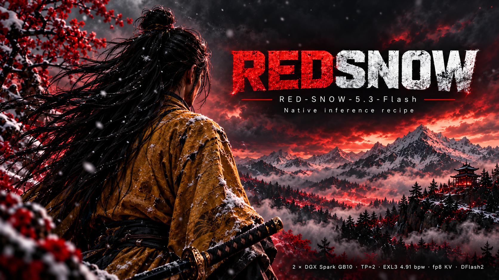

# RED-SNOW-5.3-Flash on two DGX Sparks

Serve [RED-SNOW-5.3-FLASH](https://huggingface.co/Blackfrost-AI/RED-SNOW-5.3-FLASH-BF16), Blackfrost-AI's
cyber-operations finetune of GLM-5.3-Flash, from two NVIDIA DGX Sparks joined by one QSFP cable, behind an
OpenAI-compatible API. The model is vcruz305's
[EXL3 SAGE 4.91 bpw pack](https://huggingface.co/vcruz305/RED-SNOW-5.3-FLASH-EXL3-SAGE-4.91bpw) (199.5 GB), split
across both GPUs by tensor parallelism (TP=2), with Inco AI's
[DFlash2](https://huggingface.co/incoai/GLM-5.3-Flash-DFlash2) drafter for speculative decoding.

The engine is [TensorFold](https://github.com/ashhart/TensorFold) 1.1.9's native Zig + CUDA server, from this project's
fork: [`justincasey/TensorFold` tag `redsnow-native-v1.1.0`](https://github.com/justincasey/TensorFold/tree/redsnow-native-v1.1.0).
v1.0.2's Python engine is still one setting away (`ENGINE=python`, [below](#python-engine-v102)).

One script sets it up and runs it:

```bash
cp .env.example .env        # set RANK0, RANK1, and the drafter license choice
./redsnow.sh setup          # check both nodes, install and build the engine, download the model
./redsnow.sh start          # ~100 s later: http://<rank0>:8080/v1
```

## Headline numbers

Measured 2026-10-31 on 2× DGX Spark (GB10, 128 GB), engine `redsnow-native-v1.1.0`, fp8 KV, greedy, DFlash2 on, by
`bench/native/run.py` and `bench/native/conc.py` (`./redsnow.sh bench`). Every run checks that drafted replies equal
`"draft": false` replies and that concurrent replies equal solo ones, token for token. The concurrency rows use
8 streams × 65,536 tokens (`PARALLEL=8 CONTEXT=65536`); the others hold for any stream setting.

| Measurement | Native (this release) | Python v1.0.2 |
|---|---|---|
| Decode with DFlash2, mean of 6 prompts (512 tokens each, thinking on) | **44.8 tok/s** (prose 35.5 … math 61.2) | 39.6 tok/s |
| Decode without drafting, same prompts and same replies | **27.8 tok/s** | 24.4 tok/s |
| Prefill, cold 8,757 / 32,307-token prompt | **1,513 / 1,660 tok/s** (TTFT 5.8 / 19.5 s) | ~380 tok/s |
| Time to first token, ~220-token chat prompt | **0.47 s** | 0.78 s |
| 8 chats at once, total decode | **97.8 tok/s** (2.1× one stream; worst TTFT 2.1 s) | 35.9 tok/s (requests queue) |
| Short chat sent while 4 chats decode and a cold 32K prompt fills | **0.82 s** to first token | waits for the whole fill |
| Open-loop trace (5 chats, cold 32K and 8K prompts, 7 requests in 6 s): mean submit-to-last-token | **25.8 s** (29.3 s on v1.0.0) | |
| Ready after `start` (cold page cache) | **~100 s** | ~60 s |

Needle recall (a code at 10% and 50% depth, greedy) is exact at 244K tokens with the default 2 × 274,432 window.
The speed depends on what the model writes: DFlash2's drafts are accepted far more often for code and
structured text than for free prose. Per-prompt numbers and the concurrency sweep are under [Benchmarks](#benchmarks).

## What you need

- **Two DGX Sparks** (GB10) on DGX OS (Ubuntu 24.04 with CUDA 13.0 at `/usr/local/cuda`), with nothing else on
  their GPUs: each rank holds ~100 GiB.
- **One QSFP cable** between them, addressed on both ends ([The link](#the-link)).
- **~200 GiB free disk on each node.** Each node keeps its own copy of the model.
- `python3.12-venv`, `git` and `curl` on both nodes (`sudo apt install python3.12-venv git curl`). A small venv
  holds the Hugging Face downloader and NCCL; the engine itself is one native binary built on rank 0.
- **A control machine** (either Spark works, or a Linux or macOS box) with bash 4 or newer and python3, and
  key-based ssh to both Sparks. On macOS: `brew install bash`.
- Internet on both nodes for the first setup (GitHub, ziglang.org, PyPI, Hugging Face).

## Install

```bash
git clone https://github.com/justincasey/RED-SNOW-5.3-Flash-2x-DGX-Spark.git
cd RED-SNOW-5.3-Flash-2x-DGX-Spark
cp .env.example .env
```

Edit `.env`:

- `RANK0` / `RANK1`: ssh targets of the two Sparks (`user@host`). Rank 0 serves the API.
- `ACCEPT_DFLASH2_LICENSE=yes` if the DFlash2 drafter's CC BY-NC-ND 4.0 terms (non-commercial) work for you.
  Otherwise set `DRAFTS=off`: the server decodes without drafting, at about 28 tok/s.
- Optional: `PARALLEL` and `CONTEXT` ([Streams vs context](#streams-vs-context)). The default is 2 streams of
  274,432 tokens; chat-heavy or multi-user serving wants `PARALLEL=8 CONTEXT=65536`.

Then:

```bash
./redsnow.sh setup
```

`setup` runs these steps; each can run on its own and is safe to repeat:

| Step | What it does | Time |
|---|---|---|
| `preflight` | GPU, nvcc, python, disk and memory on both nodes; finds the link and pings across it | seconds |
| `install` | fetches the pinned engine tag into `~/redsnow/native/src` (refuses any other commit), Zig 0.17.0, a small venv with the Hugging Face downloader and NCCL 2.30.7 (`config/constraints.txt`); builds the engine once on rank 0 and copies the binary to rank 1 | ~5 min |
| `download` | the pack (pinned revision) and the drafter; both nodes at once, resumable | depends on your link; ~200 GiB a node |

Everything goes under `~/redsnow` on each node (`BASE_DIR` and `MODELS_DIR` move it).

## Run

```bash
./redsnow.sh start      # both ranks; waits until the API answers (~100 s)
./redsnow.sh smoke      # one request: 17*23 must come back as 391
./redsnow.sh status     # both ranks and /health
./redsnow.sh logs       # tail of both ranks' logs
./redsnow.sh bench      # the benchmarks behind the numbers above (bench run ~10 min, bench conc ~6 min)
./redsnow.sh stop
```

Use it like any OpenAI endpoint:

```bash
curl http://<rank0>:8080/v1/chat/completions -H 'Content-Type: application/json' -d '{
  "model": "RED-SNOW-5.3-Flash",
  "messages": [{"role": "user", "content": "Explain what an SSRF vulnerability is."}],
  "max_tokens": 1024
}'
```

```python
from openai import OpenAI
client = OpenAI(base_url="http://<rank0>:8080/v1", api_key="unused")  # or your API_KEY
print(client.chat.completions.create(model="RED-SNOW-5.3-Flash",
      messages=[{"role": "user", "content": "Hello"}]).choices[0].message.content)
```

The model reasons before it answers. The reasoning comes back separately as `reasoning_content`, and it counts
toward `max_tokens`, so leave room for both.

The API has no authentication unless you set `API_KEY`. Set one if anything beyond your own machines can reach
the port.

## The link

The ranks exchange activations over the QSFP cable using RoCE (NCCL). `preflight` and `start` find the link
themselves: on each node they list the RDMA network devices that have a carrier and an IPv4 address, and pick the
pair whose addresses share a subnet. The cable may join different ports on the two nodes (port 0 on one, port 1
on the other); each rank keeps its own device names.

If the link has no addresses yet, give each end one in a private subnet, with MTU 9000. Find the cabled port with
`cat /sys/class/net/enp1s0f*np*/carrier` (1 = cabled), then, for example:

```bash
# on rank 0 (use the cabled netdev's name)
sudo nmcli con add type ethernet ifname enp1s0f0np0 con-name qsfp \
  ipv4.method manual ipv4.addresses 10.100.0.1/24 802-3-ethernet.mtu 9000
# on rank 1
sudo nmcli con add type ethernet ifname enp1s0f1np1 con-name qsfp \
  ipv4.method manual ipv4.addresses 10.100.0.2/24 802-3-ethernet.mtu 9000
```

If detection picks the wrong pair, pin all six `RANK0_IF`/`RANK0_HCA`/`RANK0_FABRIC_IP`/`RANK1_*` keys in `.env`
(python engine; the native launcher uses every rail it finds on the shared subnet). The rendezvous port (native 29741,
python 29551) and the link are not authenticated: keep the link private.

## Configuration

Precedence: environment, then `.env`, then the defaults (`redsnow.sh`, and for the native engine
`native/engine.env`). `.env.example` lists every key.

| Key | Default | Meaning |
|---|---|---|
| `RANK0`, `RANK1` | (required) | ssh targets; rank 0 serves the API |
| `ENGINE` | `native` | `native`: the Zig TensorFold 1.1.9 engine; `python`: v1.0.2's Python engine ([below](#python-engine-v102)) |
| `DRAFTS` | `on` | `on`: DFlash2 drafting; `off`: serial decode, no drafter download |
| `ACCEPT_DFLASH2_LICENSE` | `no` | must be `yes` to download the drafter |
| `SERVED_NAME` | `RED-SNOW-5.3-Flash` | model id clients send |
| `HOST`, `PORT` | `0.0.0.0`, `8080` | rank 0's API address; rank 1 takes `PORT+1` on localhost |
| `API_KEY` | (empty) | require this bearer key |
| `PARALLEL` | `2` | streams decoding at once ([Streams vs context](#streams-vs-context)); python: 1 |
| `CONTEXT` | `274432` | prompt + reply window per stream, in tokens; python: `131072` |
| `KV_DTYPE` | `fp8` | latent KV cache: `fp8` (e4m3, per-token scales) or `bf16` |
| `BASE_DIR`, `MODELS_DIR` | `~/redsnow`, `~/redsnow/models` | install and model locations, the same on both nodes |
| `MEMORY_RESERVE_GIB` | `6` | memory each rank leaves free; python: `2` |
| `NCCL_MAX_NCHANNELS` | (NCCL's) | python: `4` (fewer channels leave ~1.5 GiB more for the cache) |
| `WAIT_TIMEOUT` | `900` | seconds `start` waits for the API (native: up to `READY_S`, 1200) |

Any `TF_GLM_*`, `TF_KV_*`, `TENSORFOLD_*` or `NCCL_*` variable you set reaches both ranks. The native engine's
measured serving path needs none; its switches are documented in the engine fork's
[GLM CUDA docs](https://github.com/justincasey/TensorFold/blob/redsnow-native-v1.1.0/docs/recipes/glm-5.3-flash-cuda.md#red-snow-exl3-mul1).

## Streams vs context

The native engine sets aside a fixed number of streams (requests decoding at once), each with a context window.
Each stream keeps 244 MiB of fixed state; their KV caches come from one pool of 512-row pages, sized at boot so that
every stream can reach its full window and handed out as a stream needs them. Memory the pool leaves free becomes the
prompt cache, which holds earlier prompts so that chat follow-ups skip prefill.

The default is 2 streams with a 274,432-token window (67 × 4,096; the model allows 1,048,576). Set `PARALLEL` and
`CONTEXT` in `.env`, or for one boot:

```bash
PARALLEL=8 CONTEXT=65536 ./redsnow.sh start
```

Measured on pair B (2026-10-31, fp8 KV, 6 GiB reserve per rank). Values come from rank 0's startup line. The short
TTFT is a ~220-token chat prompt on an idle server. Boot time does not depend on the stream count.

| Streams | Context per stream | KV page pool | Model per rank | Prompt cache | Short TTFT |
|---|---|---|---|---|---|
| 2 (default) | 274,432 | 1,074 pages (3.56 GiB) | 98.41 GiB | 2.5–2.7 GiB | 0.47 s |
| 4 | 131,072 | 1,028 pages (3.41 GiB) | 98.34 GiB | 2.3 GiB | 0.48 s |
| 8 | 65,536 | 1,032 pages (3.42 GiB) | 98.31 GiB | 1.3 GiB | 0.48 s |

With 2 streams, a third request waits until a stream frees up; requests are not refused. Measured effects of the
stream count:

- At 4 streams, a short chat sent while 4 others decoded and a 32K prompt filled had no free stream and waited for
  one (42.9 s with v1.0.0).
- At 8 streams, the same chat got its first token in about 0.8 s.
- At 8 streams, 8 chats started together decode at 98 tok/s in total, 2.1× one stream.

For chat-heavy or multi-user serving, use 4 or 8 streams. Use 2 when single requests need windows past 128K
(needle recall is exact at 244K tokens).

## How it is put together

| Piece | What |
|---|---|
| Model | GLM-5.3-Flash architecture: 45 layers (3 dense + 42 MoE, 288 experts, top-8), hybrid KDA linear attention and DSA sparse attention, 1M native context |
| Weights | RED-SNOW EXL3 SAGE MixedK, 4.91 bpw, mul1 codebook, per-expert widths, 36 shards, read as downloaded (the pack's own EXL3 `lm_head`) |
| Engine | TensorFold v1.1.9's native Zig + CUDA server plus this project's 8 commits: [`justincasey/TensorFold` tag `redsnow-native-v1.1.0`](https://github.com/justincasey/TensorFold/tree/redsnow-native-v1.1.0) (`ae6404e5`; development continues on branch `redsnow-native-1.1.9`). One binary, built on rank 0 and copied to rank 1 (the ranks compare digests) |
| Split | TP=2, one rank a Spark. Rank 0 runs the API; NCCL over RoCE on every rail of the QSFP link, plus RDMA all-gathers in decode |
| Prefill | 4,096-row prompt chunks: fused mul1 routed experts (each expert's weights read once a chunk), a dense EXL3 GEMM, chunked (WY) KDA, latent attention on tensor cores; the ranks' exchanges in four row pieces |
| Decode | DFlash2 chain drafting, its confidence cut 0.4 to 0.6 by the room left in a shared window; verify windows replay CUDA graphs, with the shared expert and KDA's bf16 projections on a side stream. A drafted reply equals the `"draft": false` one token for token |
| Concurrency | several streams' windows share one forward (KDA and attention for all segments in one pass); a long prompt fills one layer at a time with decode rounds between; fresh short prompts arriving together fill in one pass; every concurrent reply equals its solo one |
| KV cache | DSA latent cache in fp8 (e4m3, fp32 row scale) on 512-row pages the streams share (6,960 bytes a token) |
| Boot | each layer's checkpoint bytes read by 8 threads while the previous layer loads; ~100 s from `start` to serving |

`native/cluster.sh` is the launcher `redsnow.sh` calls. For engine development it also syncs a local checkout
(`TF_SRC=<checkout> native/cluster.sh sync && native/cluster.sh build`), and `autoresearch.sh` is the benchmark
harness used to tune it (8 streams × 65,536, primary metric `trace_mean_s`).

## Python engine (v1.0.2)

`ENGINE=python` in `.env` serves with v1.0.2's engine instead, exactly as v1.0.2 did: TensorFold 0.6.5 + the GLM-5.3
TP=4 CUDA work of `vcruz305/TensorFold` `glm53-tp4-spark` + this project's branch `redsnow-v1` (tag `redsnow-v1.0.2`).
Its `install` builds a full PyTorch venv and the CUDA extensions (~3 min), its `download` adds one BF16 shard
holding `lm_head` (sha256-checked), and `view` builds a serve view with that head swapped in. It serves one
request at a time (others queue), with a 131,072-token window, ~102.6 GiB a rank. Its benchmarks are
`./redsnow.sh bench [smoke|decode|pin|long|sixcat|all]`, and its tuned settings (`TF_GLM_EXL3_LOADS=nc2`,
`TF_GLM_HC_SPLIT=1`, `TF_GLM_PREFILL_OVERLAP=2`, `TF_GLM_KDA_CHUNKED=1`, `TF_GLM_MTP=0`) apply only to it.

The `redsnow-v1` branch adds to TensorFold 0.6.5 + `glm53-tp4-spark`:

- dense-EXL3 support for the RED-SNOW SAGE pack: split rules, composite projections, half-step bit widths, the
  mul1 codebook, the serve view tool, and fixes for fused groups, trellis words, tail blocks and scratch
- the fp8 (and q4) latent KV cache
- MiaAI-Lab's decode-round windows, KDA chunked prefill, HC row split, prefill overlap, pool-score kernel, DFlash2
  stop rules, and the 16-byte decode loads and expert launch order (ports; see [Credits](#credits))

## Benchmarks

### Native engine (2026-10-31, `redsnow-native-v1.1.0`)

`bench/native/run.py` and `bench/native/conc.py` (what `./redsnow.sh bench run` and `bench conc` run) on a fresh
boot of pair A, at 8 streams × 65,536 (`PARALLEL=8 CONTEXT=65536`), greedy, fp8 KV, DFlash2 on, by `autoresearch.sh`.
Both fail on any drafted reply that differs from its `"draft": false` reply, or any concurrent reply that differs
from its solo one.

| Prompt (512 tokens, thinking on) | Drafted tok/s | Tokens per round | Not drafted tok/s |
|---|---|---|---|
| code | 45.24 | 3.20 | 27.81 |
| prose | 35.54 | 2.07 | 28.22 |
| math | 61.19 | 4.38 | 27.92 |
| chat_explain | 38.07 | 2.40 | 27.88 |
| chat_multiturn | 45.20 | 2.91 | 27.87 |
| long_doc | 43.59 | 3.41 | 26.85 |
| **mean** | **44.81** | **3.06** | **27.76** |

| Prefill (cold, 8 tokens out) | Prompt tokens | TTFT | Prefill |
|---|---|---|---|
| Moby-Dick slice | 8,757 | 5.81 s | 1,513 tok/s |
| Moby-Dick slice | 32,307 | 19.50 s | 1,660 tok/s |
| Chat prompt | ~220 | 0.47 s | |

Needle recall: exact at ~6K tokens (every `bench run`) and at 244K tokens (2 × 274,432, codes at 10% and 50% depth).

| Concurrency (chats of 256 tokens started together) | Total tok/s | vs 1 stream | Worst TTFT |
|---|---|---|---|
| 1 | 45.7 | 1.00× | 0.46 s |
| 2 | 48.9 | 1.07× | 0.63 s |
| 4 | 66.2 | 1.45× | 0.94 s |
| 8 | 97.8 | 2.14× | 2.06 s |

| Mixed load | Result |
|---|---|
| 4 chats decoding while a cold 32K prompt fills: longest gap between their tokens | 0.46 s |
| A short chat sent during that fill: time to first token | 0.82 s |
| The 32K prompt's own TTFT under that load (it shares the GPU with the decoders) | 52.1 s |
| Open-loop trace (5 chats + cold 32K and 8K prompts, 7 requests in 6 s): mean submit-to-last-token | 25.8 s |

Against `redsnow-native-v1.0.0` on the same pair and harness (2026-10-30): the trace's mean 29.3 → 25.8 s (its chats
finish about 5 s sooner each), single-stream decode, prefill and the C sweep level (v1.0.0: 45.0 tok/s, 1,509 / 1,661
tok/s, 48.2 / 65.6 / 98.0 tok/s at 2 / 4 / 8). The cost is the long prompt beside decoders: one layer of its chunk a
decode round (`TF_GLM_FILL_LAYERS=1`) gives the chats their pace, and its own first token comes later (32K: 52 s
against 46 s; `TF_GLM_FILL_LAYERS=2` restores that order).

### Python engine v1.0.2 baseline (2026-10-10)

`./redsnow.sh bench all` on a fresh boot, run on rank 0. The suite is adapted from vcruz305's
[GLM-5.3 recipe](https://github.com/vcruz305/GLM-5.3-EXL3-DGX-Spark-recipe) (`bench/`, MIT) and
[SixCat](https://github.com/vcruz305/sixcat-eval) v0.7.0. Raw output:
[`bench/records/2026-10-10-v1.0.2-baseline/`](bench/records/2026-10-10-v1.0.2-baseline/).

| Step | What it runs |
|---|---|
| `bench smoke` | `/v1/models`, `/health`, `/tokenize` against the pinned prompt ids, thinking on/off channel split and markup leaks, the reply streaming round by round, drafted == `"draft": false` on a short reply, DFlash2 as the default drafter, an invalid `tf_policy` refused |
| `bench decode` | 6 prompts (thinking on, greedy, 512 tokens): one `"draft": false` run and 3 drafted runs each (the first prefills the prompt, the others resume it from the prompt cache); every reply must equal the serial ids pinned in `bench/redsnow_reference.json` |
| `bench long` | a 127.5K-token Project Gutenberg prompt (sha256-pinned book), not drafted then drafted: TTFT, prefill, decode, and drafted == not drafted |
| `bench sixcat` | SixCat `speed --policy strict --thinking off`: decode, balanced and prefill profiles at one request in flight |
| `bench pin` | writes a new `bench/redsnow_reference.json` |

| Prompt | Prompt tokens | Drafted tok/s (median of 3) | Tokens per round | TTFT | Not drafted tok/s |
|---|---|---|---|---|---|
| code | 221 | 39.71 | 3.01 | 0.78 s | 24.62 |
| prose | 214 | 31.93 | 2.19 | 0.77 s | 24.61 |
| math | 228 | 55.85 | 4.71 | 0.81 s | 24.55 |
| chat_explain | 242 | 34.81 | 2.56 | 0.85 s | 24.54 |
| chat_multiturn | 342 | 35.14 | 2.42 | 1.12 s | 24.53 |
| long_doc | 3,011 | 39.95 | 3.13 | 8.24 s | 23.79 |
| **mean** | | **39.57** | | | **24.44** |

Every drafted reply equals the `"draft": false` reply (31/31 checks). The TTFT column is the first request; a
repeat of the same prompt resumes from the prompt cache in 0.08–0.21 s.

| Long prompt (127,712 tokens) | TTFT | Prefill | Decode (512 tokens) |
|---|---|---|---|
| not drafted | 334.3 s | 382.0 tok/s | 22.73 tok/s |
| drafted (same reply) | 335.6 s | 380.6 tok/s | 34.93 tok/s (2.65 tokens per round) |

| SixCat profile (one request in flight) | p50 |
|---|---|
| decode, synthetic word-list prompt, up to 512 tokens | 67.37 tok/s |
| prefill, ~2,640-token prompt | 378.6 tok/s, TTFT 6.98 s |
| balanced, ~400-token prompt, 128 tokens | 36.17 tok/s aggregate, TTFT p95 1.67 s |

Quote the 6-prompt mean as the speed a user sees. SixCat's decode prompt drafts far better than real text, so its
number is a ceiling. An earlier SixCat run with 1, 2, 4 and 8 requests in flight measured the same ~35.9 tok/s
aggregate at each level: requests queue, so `bench sixcat` stops the concurrency curve at one.

The pinned reference is a token-for-token regression check. A change meant to keep outputs (decode-only work) must
reproduce it. A change that alters prefill numerics re-pins with `bench pin`, only after the needle test and
`bench smoke` pass, and its commit says so.

v1.0.1 ([record](bench/records/2026-10-10-v1.0.1-baseline/)) measured a 41.43 tok/s mean, but its drafted replies
were not the `"draft": false` ones: they parted at token 0 to 94. They were other texts, and these happened to draft
better. v1.0.2 makes drafted and serial replies agree. A decode round costs the same (code 76 ms vs 78 ms,
chat_multiturn 69 ms vs 72 ms), and on the six prompts' serial texts DFlash2 accepts fewer tokens per round.

### Python engine v1.0.0 run (2026-10-10)

Measured with v1.0.0's `bench/bench.py` (replaced by the suite above in v1.0.1). One warm-up request first, then
every request starts with a fresh nonce, except the canonical prose arm, which uses the fixed prompt that every
earlier number in this project used.

| Arm | Runs (decode tok/s) | Tokens per round | TTFT |
|---|---|---|---|
| Prose, canonical prompt (214 tokens → 256) | 35.9 / 36.9 / 36.9 | 2.55 / 2.63 / 2.60 | 0.77 s |
| Prose, four other prompts (→ 256) | 31.9 / 31.2 / 36.7 / 32.7 | 2.02 / 2.16 / 2.63 / 2.20 | 0.75–0.83 s |
| Code (231 tokens → 512) | 46.3 / 50.9 / 47.1 | 3.68 / 4.12 / 3.81 | 0.82 s |
| JSON array (240 tokens → 512) | 48.7 / 49.3 / 52.6 | 3.87 / 3.96 / 4.15 | 0.83 s |
| TTFT ~1,200 tokens | | | 3.42 / 3.43 s (350 tok/s) |
| TTFT ~4,200 tokens | | | 10.98 / 10.89 s (384 tok/s) |
| TTFT ~16,200 tokens | | | 39.55 / 39.57 s (410 tok/s) |
| 4 simultaneous prose requests | 33.0 / 32.2 / 32.7 / 34.9 each | | 1,024 tokens in 34.0 s = 30.1 tok/s aggregate |

A second boot gave prose 30.5–33.1 and code 47.7–50.4 with other nonces, and JSON 49.6–51.8. CUDA serves one
request at a time, so concurrent requests queue. Each one is answered correctly, but there is no aggregate gain.

Needle recall (a code buried in filler, greedy): exact at 90,210 tokens (prefill 215 s, 419 tok/s) and at 36,210
tokens.

### Python engine: settings A/B

Each arm is a fresh boot. The protocol is the canonical prose prompt (3 runs), plus ~16K-token prompts for TTFT.

| Arm | Prose tok/s | TTFT ~16K |
|---|---|---|
| Baseline (fp8 KV, no decode loads) | 33.4 / 35.5 / 35.9 | — |
| `TF_GLM_EXL3_LOADS=nc2` | 36.0 / 37.2 / 37.4 (**+4.5%**) | — |
| `TF_GLM_EXL3_LOADS=nc4` | 35.7 / 36.9 / 37.0 | — |
| `TF_GLM_EXL3_SWZ=2` (expert launch order) | 34.9 / 35.8 / 36.0 (noise) | — |
| `TF_GLM_L2PF=bulk` (L2 prefetch; removed from v1) | 35.2 / 36.2 / 36.2 (noise) | — |
| nc2, prefill settings off | 36.1 / 37.4 / 37.3 | 42.0 / 42.4 / 42.4 s |
| nc2, prefill settings on (v1) | 35.9 / 36.8 / 37.0 | 39.3 / 39.6 / 39.6 s (**−6%**) |

Every arm passed the layer parity check (EXL3 groups, both ranks, against a float64 reference) before it was
benchmarked.

### Python engine: KV cache precision and capacity

| KV | Prose tok/s | Memory at 128K | Notes |
|---|---|---|---|
| bf16 | 31.2 (tpr 2.16) | ~103.4 GiB | needle exact at 39K |
| fp8 (v1) | 33.4–33.8 (tpr 2.36) | 102.55 GiB | needle exact at 39K (same tokens per round as bf16) and at 90K |

Before the nc2 and prefill work. The engine also has a q4 latent cache (not part of this recipe's path).
Measured startup estimates, out of ~113.5 GiB:

| KV | Window | GiB a rank |
|---|---|---|
| q4 | 192K | 102.80 |
| q4 | 256K | 103.39 |
| fp8 | 256K | 104.08 |
| q4 | 512K | 105.76 |
| q4 | 1M (native) | 110.50 |

Each extra token costs ~9.7 KiB, mostly indexer keys and scratch. The latent itself is 2.75 KiB of that, so fp8
and q4 differ little until the window gets very large.

### Python engine: where decode time goes

One drafted round takes ~67 ms of wall time: ~4.8 ms drafting, and the rest is the target forward on both ranks.
The GPU kernels inside it sum to 59.1 ms (torch profiler trace, fp8 KV, before nc2):

| Kernel | ms a round | Share |
|---|---|---|
| MoE routed experts (EXL3 trellis, 78 launches) | 22.2 | 38% |
| Dense and shared linears (EXL3) | 14.7 | 25% |
| Per-head attention (`_bmm`) | 4.6 | 8% |
| NCCL all-gather | 2.5 | 4% |
| Rotation glue | 2.3 | 4% |
| Everything else | ~13 | 22% |

A read probe on the loaded server reached ~200–230 GB/s. The expert launches stream weights near that rate, so
decode is bound by memory bandwidth at 4.91 bpw, not by kernel launches. Each extra verify row costs ~6 ms.
Faster decode needs higher draft acceptance or fewer weight bytes; fusing kernels only removes 1–3 ms of gaps.

### Python engine: drafting policies

| Policy | Prose tok/s | Tokens per round |
|---|---|---|
| No drafting (`DRAFTS=off`) | ~25 | 1 |
| Adaptive DFlash2 chain (v1) | 30–37 | 2.0–2.6 |
| MTP head only, depth 1 / 2 / 3 | 30.2 / 31.5 / 30.1 | 1.67 / 1.99 / 2.16 |
| DFlash2 chain, depth 5, confidence cut 0.25 / 0.35 | 30.2–30.5 / 31.7 | 2.18 / 2.12 |
| Noise-aware stop rule `fnc7:0.3` | 32.8–32.9 | 1.99 |
| Tree drafting, 2 branches × depth 2 / 3 | 23.3 / 20.2 | 2.14 / 2.32 |

Measured 2026-10-09/10, before nc2, with an older prose prompt that runs a few tok/s below the canonical one, so
compare rows, not these numbers against the v1 run. DFlash2's side branches are accepted far less often than its
main chain, so tree drafting loses to the wider verify windows it needs. NCCL channel counts (2/4/8), LL128 and
NVLS measured flat.

### Python engine: prefill

Prefill is ~60% MoE, ~23% KDA and ~14% DSA (profiled 2.7K-token chunk). The three prefill settings cut 16K TTFT
by 6% (A/B above). The engine's optional fp8 MoE prefill route (`--prefill-fp8`, not in v1) was a further ~5%
faster at 16K in a same-day A/B (453 vs 430 tok/s), slower under 2,048 tokens, and lowered drafting acceptance a
little at long context; v1 keeps bf16 prefill.

### For reference

MiaAI-Lab's vLLM stack on the same hardware and model family (GLM-5.3-Flash EXL3, TP=2) reports 27.1 tok/s on
prose, 35–44 on code and structured output, and up to 65 on highly predictable structured output.

## Known limits

- Native: the number of streams is fixed at boot. With the default 2, a third request waits for a free stream
  (it is answered correctly, just later); use `PARALLEL=8 CONTEXT=65536` for many users.
- Native: a long prompt filling beside decoding streams shares the GPU with them, so its own first token comes later
  (a cold 32K prompt: 19.5 s alone, ~52 s beside 4 decoding chats), while theirs keep coming. `TF_GLM_FILL_LAYERS`
  (layers of its chunk a decode round, default 1) trades the two: 2 gives ~46 s, at the chats' pace.
- Native: kept prompt states (the prompt cache) resume only on 4,096-token boundaries.
- Prose decode depends on the text: 35 tok/s native (30–37 python) across the prompts above.
- Python engine: one request decodes at a time; concurrent requests queue. A stop string ends the streamed text at
  once, but the request finishes only when decoding reaches an end token or `max_tokens`. Each start logs
  `CUDA extension … waits on the build lock …` lines for kernels already built; they are harmless. The
  `test_exl3_experts` bit-identity checks fail identically on the pre-graft tree (last-ulp differences in the
  grouped kernel, present before the nc2 work).

## Credits

**Model**

- [GLM-5.3-Flash](https://huggingface.co/zai-org) by Z.AI (zai-org), MIT License: the base model.
- [RED-SNOW-5.3-FLASH-BF16](https://huggingface.co/Blackfrost-AI/RED-SNOW-5.3-FLASH-BF16) by
  [Blackfrost-AI](https://huggingface.co/Blackfrost-AI), MIT License: the finetune. Its card asks that it be used by
  experienced operators in environments they own or are explicitly authorized to assess, with a human operator
  kept in control of scope, target selection, credentials, tool execution and destructive actions. This recipe
  passes that on: read the card before you deploy.
- [RED-SNOW-5.3-FLASH-EXL3-SAGE-4.91bpw](https://huggingface.co/vcruz305/RED-SNOW-5.3-FLASH-EXL3-SAGE-4.91bpw) by
  [vcruz305](https://huggingface.co/vcruz305) (Victor Cruz), with Blackfrost-AI, MIT License (copied from the BF16
  release, Copyright 2026 Z.AI Co., Ltd.): the quantized pack this recipe serves.
- [GLM-5.3-Flash-DFlash2](https://huggingface.co/incoai/GLM-5.3-Flash-DFlash2) by [Inco AI](https://inco.ai),
  CC BY-NC-ND 4.0: the drafter. Cite as the card asks:

  ```bibtex
  @misc{inco2026dflash2, title={{DFlash 2: Keep Drafting Parallel}}, author={{Inco AI}}, year={2026},
        month={August}, url={https://inco.ai/blog/dflash2/}}
  @inproceedings{chen2026dflash, title={{DFlash: Block Diffusion for Flash Speculative Decoding}},
        author={Chen, Jian and Liang, Yesheng and Liu, Zhijian}, booktitle={ICML}, year={2026}}
  ```

**Engine**

- [TensorFold](https://github.com/ashhart/TensorFold) by Ash Hart and the TensorFold contributors, Apache-2.0
  (code before 0.6.0 also MIT): the engine. The native engine is TensorFold v1.1.9's Zig + CUDA server, which now
  includes the upstream changes v1.0.0 carried: the first-token handoff (Jonathan Regan-Beasley; Ash Hart) and idle
  ranks sleeping between streams (upstream PR #1053).
- [vcruz305/TensorFold](https://github.com/vcruz305/TensorFold) `glm53-tp4-spark`: the GLM-5.3 TP=4 CUDA engine
  by drowzeys (prompt experts, decode linears, concurrency, sequence-parallel prefill, NCCL grouping) and fixes by
  vcruz305. The fork carries these commits unchanged, under their original authors.
- [MiaAI-Lab's GLM-5.3-Flash EXL3 TensorFold patch series](https://github.com/MiaAI-Lab/GLM-5.3-Flash-EXL3-2x-DGX-Sparks-TensorFold)
  by MiaAI-Lab and contributors, Apache-2.0. Ported designs: 0010 (HC row split), 0012/0039/0014 (KDA chunked
  prefill), 0013 (decode rounds, kv_b formats), 0018 (DFlash2 noise-aware stop rules), 0033 (prefill overlap),
  0086 (pool scores), 0047 (decode loads) and 0090 (expert launch order). The last two are adapted from
  [Jay Leaton's glm53-tensorfold-spark](https://github.com/jayleaton/glm53-tensorfold-spark) (Apache-2.0).
  Per-file detail: the fork's `THIRD_PARTY_NOTICES.md`.
- [MiaAI-Lab's GLM-5.3-Flash-EXL3-2x-DGX-Sparks](https://github.com/MiaAI-Lab/GLM-5.3-Flash-EXL3-2x-DGX-Sparks)
  vLLM recipe: the reference for this stack's layout and numbers. No code from it is included.
- [ExLlamaV3](https://github.com/turboderp-org/exllamav3) by turboderp, MIT: the EXL3 format. TensorFold's
  decoders are separate implementations checked bit for bit against it. vcruz305's ExLlamaV3 fork was the parity
  oracle for this port.
- [z-lab/dflash](https://github.com/z-lab/dflash), MIT: the DFlash drafter architecture.

**Benchmarks**

- `bench/bench_v1.py`, `bench/longctx_run.py`, `bench/make_prompts.py` and the six prompts in
  `bench/sweep6_prompts.json` are adapted from vcruz305's
  [GLM-5.3-EXL3-DGX-Spark-recipe](https://github.com/vcruz305/GLM-5.3-EXL3-DGX-Spark-recipe) (`ed2f31d`), MIT,
  © 2026 Victor Cruz ([notice](bench/LICENSE-vcruz305)). Each file's header lists the changes.
- [SixCat](https://github.com/vcruz305/sixcat-eval) v0.7.0 by Victor Cruz, MIT: `bench sixcat` installs it on
  rank 0 in its own venv.

## Licenses

This repository's scripts and documentation: Apache-2.0 ([LICENSE](LICENSE)), except the benchmark files adapted from
vcruz305's recipe, which stay MIT ([notice](bench/LICENSE-vcruz305)). The engine fork: Apache-2.0, with
the MIT notice for TensorFold code written before 0.6.0, and third-party notices in its `THIRD_PARTY_NOTICES.md`.
The model files are not part of this repository. `download` fetches them from Hugging Face under their own
licenses: MIT for the RED-SNOW pack and the BF16 release, and **CC BY-NC-ND 4.0 for the DFlash2 drafter** (research
and non-commercial use; commercial licensing: contact@inco.ai). With `DRAFTS=off` the drafter is never
downloaded.
